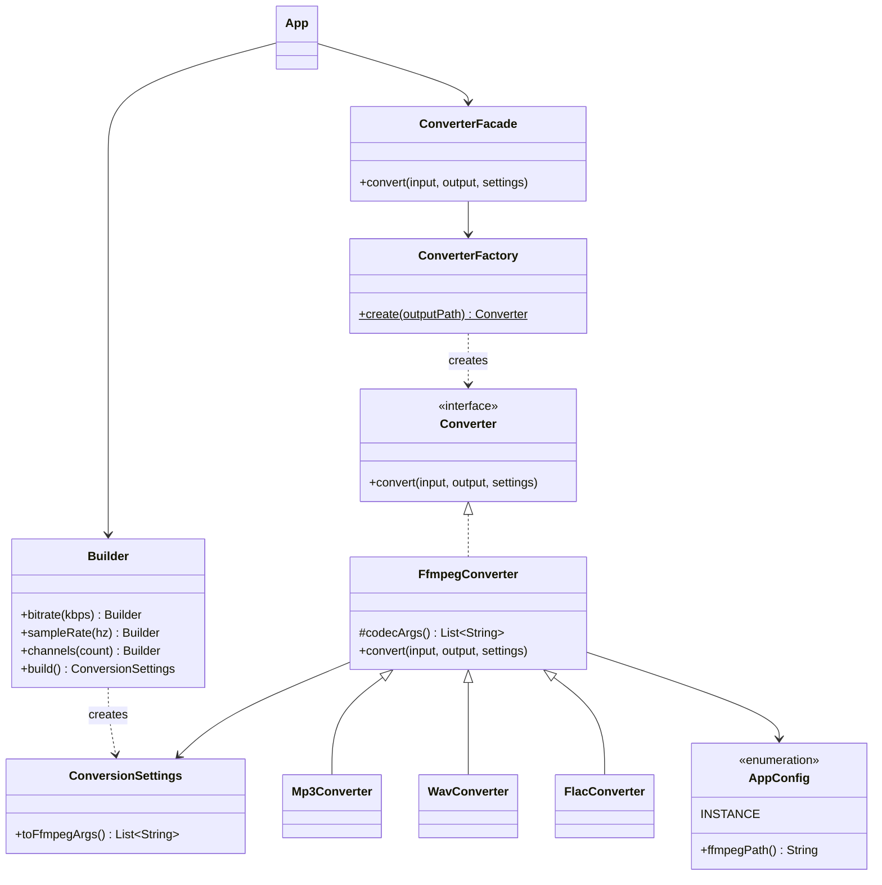

# Laboratory work 1

## Theory 

Creational design patterns - creational design patterns provide various object creation mechanisms, which increase flexibility and reuse of existing code.

## Problem statement

First laboratory work for TMPS course with the topic "Creational Design Patterns".

To implement in a project 3 creational design patterns from the following list:

    Singleton
    Builder
    Prototype
    Object Pooling (not required, good to know)
    Factory Method
    Abstract Factory

and to know the rest.

## Implementation

### Project Idea

This project attempts to implement a universal audio file converter in the Java programming language. The idea is the following:
- Give an audio file as input in one format;
- Receive an audio file as output in another format.

### Project Overiew

The final implementation of the project must follow the structure:

```
Input file
   │
   ▼
Demuxer      → splits the container into streams of compressed packets
   │
   ▼
Decoder      → compressed packets → raw PCM frames
   │
   ▼
Filters      → optional: resample, volume, channel remix, trim, etc.
   │
   ▼
Encoder      → raw PCM frames → compressed packets
   │
   ▼
Muxer        → packs the packets into the output container
   │
   ▼
Output file
```

In the present project, due to the complexity of implementation of encoders, the projects mimics the necessary behavior by using **ffmpeg** as the internal conversion engine, so it currently only represents the following structure:

```
Input file
   │
   ▼
Ffmpeg      → splits the container into streams of compressed packets
   │
   ▼
Output file
```

The usage of **ffmpeg** is temporary and will be decomposed in smaller processes in future updates.

### Project structure
 
The project is a Maven project (Java 17) with the base package `io.github.Makday`.
 
```
kaleidosound/
├── pom.xml
└── src/
    ├── main/java/io/github/Makday/
    │   ├── App.java                       # CLI entry point
    │   ├── ConverterFacade.java           # simple API over the whole subsystem
    │   ├── config/
    │   │   └── AppConfig.java             # Singleton
    │   ├── settings/
    │   │   └── ConversionSettings.java    # Builder
    │   └── converter/
    │       ├── Converter.java             # product interface
    │       ├── ConverterFactory.java      # Factory Method
    │       ├── FfmpegConverter.java       # base converter (runs ffmpeg)
    │       ├── Mp3Converter.java          # concrete products
    │       ├── WavConverter.java
    │       └── FlacConverter.java
    └── test/java/io/github/Makday/
        └── AppTest.java
```
 
The relations between the main classes:
 

 
### General code explanation
 
The flow of a conversion is the following: `App` parses the command line arguments and builds a `ConversionSettings` object, then hands everything to `ConverterFacade`. The facade asks `ConverterFactory` for a `Converter` suited for the requested output format, and the converter launches `ffmpeg` as an external process.
 
**Entry point.** `App` reads the mandatory input/output paths and the optional bitrate, sample rate and channel count:
 
```java
ConversionSettings.Builder builder = new ConversionSettings.Builder();
if (args.length > 2)
  builder.bitrate(Integer.parseInt(args[2]));
if (args.length > 3)
  builder.sampleRate(Integer.parseInt(args[3]));
if (args.length > 4)
  builder.channels(Integer.parseInt(args[4]));
 
new ConverterFacade().convert(args[0], args[1], builder.build());
```
 
**Facade.** `ConverterFacade` hides the creation and execution of a converter behind a single method and centralizes error handling, so the client code does not need to know about factories or processes:
 
```java
class ConverterFacade {
  public void convert(String input, String output, ConversionSettings settings) {
    try {
      Converter converter = ConverterFactory.create(output);
      converter.convert(input, output, settings);
      System.out.println("Done: " + output);
    } catch (Exception e) {
      System.err.println("Conversion failed: " + e.getMessage());
    }
  }
}
```
 
**Converter contract.** All converters implement a single-method interface:
 
```java
public interface Converter {
  void convert(String input, String output, ConversionSettings settings)
      throws IOException, InterruptedException;
}
```
 
**Conversion engine.** `FfmpegConverter` assembles the `ffmpeg` command line and runs it with `ProcessBuilder`. The part that differs between formats (the codec) is isolated in the overridable method `codecArgs()`:
 
```java
public class FfmpegConverter implements Converter {
  protected List<String> codecArgs() {
    return List.of();
  }
 
  @Override
  public void convert(String input, String output, ConversionSettings settings)
      throws IOException, InterruptedException {
    List<String> cmd = new ArrayList<>(List.of(
        AppConfig.INSTANCE.ffmpegPath(), "-y", "-loglevel", "error", "-i", input, "-vn"));
    cmd.addAll(codecArgs());
    cmd.addAll(settings.toFfmpegArgs());
    cmd.add(output);
 
    ProcessBuilder pb = new ProcessBuilder(cmd);
    pb.inheritIO();
    int exitCode = pb.start().waitFor();
    if (exitCode != 0) {
      throw new IOException("FFmpeg failed with exit code " + exitCode);
    }
  }
}
```
 
The `-vn` flag drops any video stream (e.g. cover art), so only audio ends up in the output. Subclasses only provide the codec, for example:
 
```java
class Mp3Converter extends FfmpegConverter {
  @Override
  protected List<String> codecArgs() {
    return List.of("-codec:a", "libmp3lame");
  }
}
```
 
`WavConverter` uses `pcm_s16le` and `FlacConverter` uses `flac` in the same way.
 
## Creational patterns used
 
Three creational patterns were implemented: **Singleton**, **Builder** and **Factory Method**.
 
### 1. Singleton — `AppConfig`
 
**Intent.** Guarantee that a class has exactly one instance and provide a global access point to it.
 
**Where and how.** The application needs one place that knows where the `ffmpeg` executable is. The path is read from the `FFMPEG_PATH` environment variable, falling back to `ffmpeg` from the system `PATH`. The singleton is implemented as a single-element `enum`:
 
```java
public enum AppConfig {
  INSTANCE;
 
  private final String ffmpegPath = System.getenv().getOrDefault("FFMPEG_PATH", "ffmpeg");
 
  public String ffmpegPath() {
    return ffmpegPath;
  }
}
```
 
It is used by the converter through `AppConfig.INSTANCE.ffmpegPath()`.
 
**Why this way.**
- The `enum` approach is the one recommended by Joshua Bloch (*Effective Java*): the JVM guarantees that `INSTANCE` is created exactly once, in a thread-safe manner, without any `synchronized` or double-checked locking code.
- It is protected against the two classic ways of breaking a singleton: reflection (an enum constructor cannot be invoked) and serialization (enum deserialization always returns the same constant).
- The configuration is read once, at class initialization, so every converter works with the same, consistent value instead of querying the environment repeatedly.
- It is very compact: the whole pattern fits into a few lines.
The trade-off is the usual one for singletons: `FfmpegConverter` depends on global state, which makes it harder to substitute the path in unit tests. This could later be improved by passing the config through a constructor.
 
### 2. Builder — `ConversionSettings`
 
**Intent.** Separate the construction of a complex object from its representation, so that the same process can create objects with different sets of parameters.
 
**Where and how.** A conversion can be tuned by three *optional* parameters: bitrate, sample rate and number of channels. `ConversionSettings` is an immutable object with a private constructor that can only be created through its nested `Builder`:
 
```java
public final class ConversionSettings {
  private final Integer bitrateKbps;
  private final Integer sampleRate;
  private final Integer channels;
 
  private ConversionSettings(Builder b) {
    this.bitrateKbps = b.bitrateKbps;
    this.sampleRate = b.sampleRate;
    this.channels = b.channels;
  }
  // ...
 
  public static class Builder {
    private Integer bitrateKbps;
    private Integer sampleRate;
    private Integer channels;
 
    public Builder bitrate(int kbps) {
      this.bitrateKbps = kbps;
      return this;
    }
 
    public Builder sampleRate(int hz) {
      this.sampleRate = hz;
      return this;
    }
 
    public Builder channels(int count) {
      this.channels = count;
      return this;
    }
 
    public ConversionSettings build() {
      return new ConversionSettings(this);
    }
  }
}
```
 
Fields are wrapper `Integer`s on purpose: `null` means "not specified, keep the source value". `toFfmpegArgs()` then emits only the arguments that were actually set:
 
```java
public List<String> toFfmpegArgs() {
  List<String> args = new ArrayList<>();
  if (bitrateKbps != null) {
    args.add("-b:a");
    args.add(bitrateKbps + "k");
  }
  if (sampleRate != null) {
    args.add("-ar");
    args.add(String.valueOf(sampleRate));
  }
  if (channels != null) {
    args.add("-ac");
    args.add(String.valueOf(channels));
  }
  return args;
}
```
 
**Why this way.**
- With three optional parameters there are 2³ = 8 possible combinations. Without a builder this would require either a "telescoping" set of constructors or a constructor with `null` placeholders, where `new ConversionSettings(null, 44100, null)` is unreadable. With the builder the call reads like a sentence: `.sampleRate(44100)`.
- `App` can set only those parameters the user typed on the command line, which maps naturally onto the builder's step-by-step API.
- The resulting object is immutable (`final` fields, no setters), so it can safely be passed around and reused.
- New options (e.g. volume, trim) can be added to the builder without changing existing calls.
### 3. Factory Method — `ConverterFactory`
 
**Intent.** Define an interface for creating an object, but let the creation logic decide which concrete class to instantiate, so that client code depends only on the abstraction.
 
**Where and how.** The client (`ConverterFacade`) needs *a* `Converter` but should not know which one. `ConverterFactory.create()` selects the concrete class by the extension of the output file:
 
```java
public final class ConverterFactory {
  private ConverterFactory() {
  }
 
  public static Converter create(String outputPath) {
    String ext = outputPath.substring(outputPath.lastIndexOf('.') + 1).toLowerCase();
    return switch (ext) {
      case "mp3" -> new Mp3Converter();
      case "wav" -> new WavConverter();
      case "flac" -> new FlacConverter();
      default -> new FfmpegConverter();
    };
  }
}
```
 
The products form a small hierarchy: the `Converter` interface, the base `FfmpegConverter`, and the package-private `Mp3Converter`, `WavConverter`, `FlacConverter`. The facade only ever sees the `Converter` interface:
 
```java
Converter converter = ConverterFactory.create(output);
converter.convert(input, output, settings);
```
 
**Why this way.**
- The calling code does not contain any `if`/`switch` over formats and does not depend on concrete classes. The concrete converters are package-private, so they cannot even be referenced from outside the `converter` package, which enforces the use of the factory.
- Adding a new format is local and cheap: write a new subclass overriding `codecArgs()` (e.g. `OggConverter` with `libvorbis`) and add one `case` line. Nothing else changes (Open/Closed Principle).
- Unknown extensions fall back to the plain `FfmpegConverter`, which passes no explicit codec so that ffmpeg picks the default one for that container.
- Putting only the codec-specific part into `codecArgs()` avoids duplicating the process-launching code in every converter.
**Remark.** Strictly speaking, the classic GoF *Factory Method* is a method that subclasses override to decide what to create. Here the creation method is `static` and chooses the product with a `switch`, which is the common *static factory method* (simple factory) variant of the pattern. The idea of the pattern (hiding the choice of the concrete class behind a creation method and returning an abstraction) is the same. The `codecArgs()` hook in `FfmpegConverter` additionally lets subclasses customize the algorithm in the manner of the Template Method pattern. If a strict GoF form is required, the creation could be moved into overridable methods of creator classes (e.g. `Mp3ConverterCreator`), at the price of more classes.
 
### Summary of the patterns
 
| Pattern | Class | Problem it solves |
|---|---|---|
| Singleton | `AppConfig` | One shared, consistently-read source of the ffmpeg path |
| Builder | `ConversionSettings.Builder` | Readable creation of an immutable object with many optional parameters |
| Factory Method | `ConverterFactory` | Choosing the right converter without coupling the client to concrete classes |
 
`ConverterFacade` is a *structural* pattern (Facade) and is not part of the required three; it just gives the client one simple entry point to the subsystem.
 
## Usage example
 
**Requirements:** JDK 17+, Maven (or the included wrapper) and `ffmpeg` installed and available in `PATH` (otherwise set `FFMPEG_PATH`).
 
**Build:**
 
```bash
./mvnw clean compile
```
 
**Run.** The arguments are `<input> <output> [bitrateKbps] [sampleRate] [channels]`:
 
```bash
# 1. Simple conversion: WAV -> MP3, default quality
java -cp target/classes io.github.Makday.App song.wav song.mp3
 
# 2. With settings: 192 kbps, 44.1 kHz, stereo
java -cp target/classes io.github.Makday.App song.wav song.mp3 192 44100 2
 
# 3. MP3 -> FLAC, 48 kHz, mono
java -cp target/classes io.github.Makday.App song.mp3 song.flac 320 48000 1
```
 
> Note: arguments are positional, so to set the sample rate a bitrate must be passed before it. For lossless formats such as FLAC the bitrate value has no real effect on quality, so any value can be used as a placeholder.
 
Example 2 produces the following output:
 
```
Done: song.mp3
```
 
and internally launches the command assembled by `FfmpegConverter`:
 
```bash
ffmpeg -y -loglevel error -i song.wav -vn -codec:a libmp3lame -b:a 192k -ar 44100 -ac 2 song.mp3
```
 
Where each part comes from:
 
| Part of the command | Produced by |
|---|---|
| `ffmpeg` | `AppConfig.INSTANCE.ffmpegPath()` (Singleton) |
| `-codec:a libmp3lame` | `Mp3Converter.codecArgs()`, chosen by `ConverterFactory` from `.mp3` (Factory Method) |
| `-b:a 192k -ar 44100 -ac 2` | `ConversionSettings.toFfmpegArgs()` (Builder) |
 
**Programmatic usage** of the patterns without the CLI:
 
```java
ConversionSettings settings = new ConversionSettings.Builder()
    .bitrate(192)
    .sampleRate(44100)
    .channels(2)
    .build();
 
Converter converter = ConverterFactory.create("song.mp3");
converter.convert("song.wav", "song.mp3", settings);
```
 
If `ffmpeg` fails (for instance, the input file does not exist), the exit code is checked and the facade prints the error instead of crashing:
 
```
Conversion failed: FFmpeg failed with exit code 1
```
 
## Conclusion
 
In this laboratory work three creational design patterns were implemented in the audio converter project:
 
- **Singleton** (`AppConfig`) provides a single, thread-safe point of access to the application configuration, here the location of the `ffmpeg` executable.
- **Builder** (`ConversionSettings.Builder`) makes the creation of an immutable settings object with several optional parameters readable and extensible.
- **Factory Method** (`ConverterFactory`) hides the choice of the concrete converter behind the `Converter` interface, so that supporting a new format only needs a new small subclass and one line in the factory.
Together they made the code more flexible and easier to extend: formats, settings and configuration can evolve independently, and the client code (`ConverterFacade`, `App`) does not depend on how objects are created. The `Facade` additionally keeps the usage of the whole subsystem simple.
 
The current implementation delegates the real audio processing to `ffmpeg`, which is a temporary solution. When the pipeline is decomposed into its own stages (demuxer, decoder, filters, encoder, muxer), the patterns will be reused and the others from the list can be applied naturally: **Abstract Factory** to create a consistent family of decoder/encoder/muxer for a format, and **Prototype** to clone pre-configured settings or filter chains. Possible improvements for the current code are validation of the values in the builder (e.g. positive bitrate), named command-line options instead of positional ones, and passing `AppConfig` into converters to simplify testing.
 
