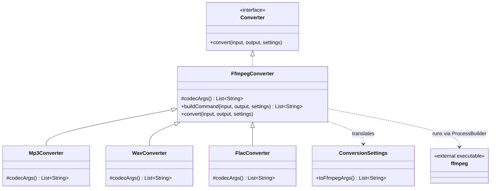
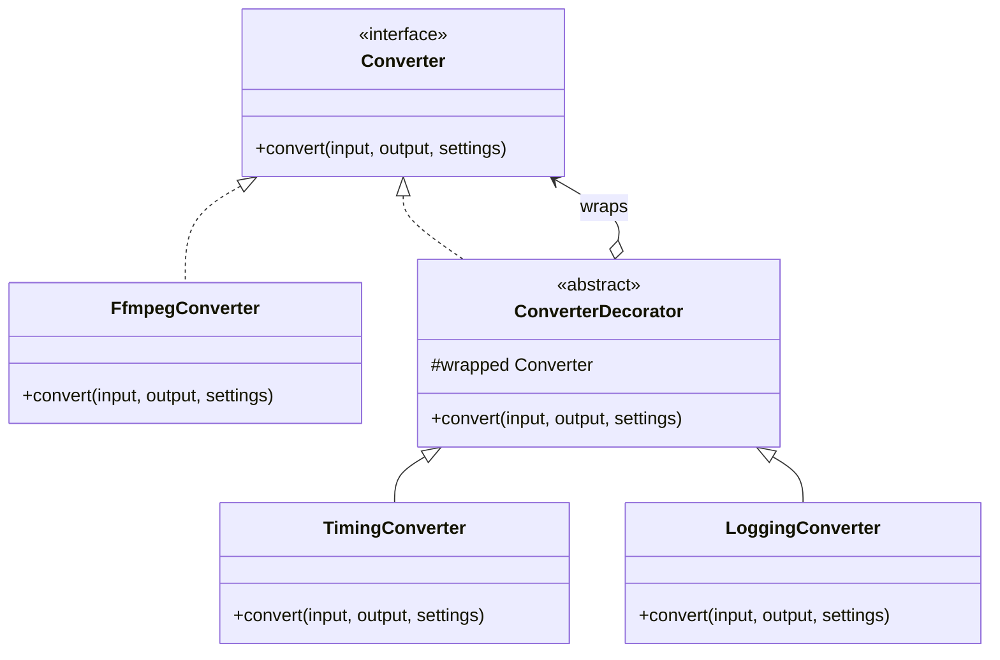
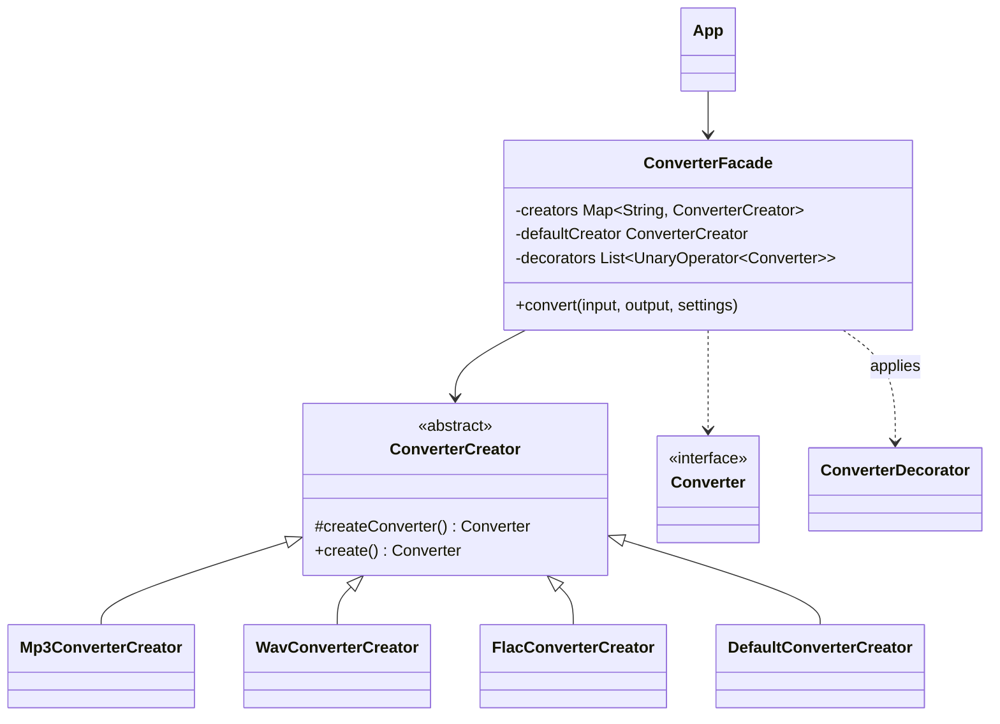
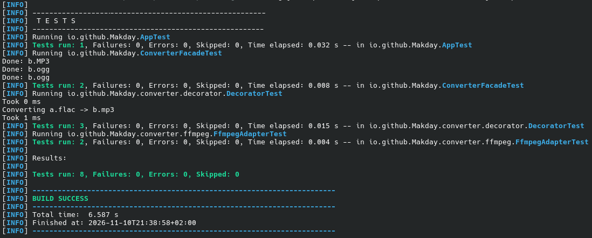

# Laboratory Work No. 2 — Structural Design Patterns

**Project:** Universal audio file converter (Java 17, Maven, base package `io.github.Makday`)

## 1. Domain description

The application converts an audio file from one format to another: the user gives an input file and an output file name (optionally bitrate, sample rate and channel count) and gets the converted file back.

A complete converter would follow the pipeline *demuxer → decoder → filters → encoder → muxer*. Because writing encoders is out of scope, the project currently delegates the whole pipeline to the external **ffmpeg** program, hidden behind our own `Converter` interface. This is temporary: ffmpeg will later be replaced by separate demuxer/decoder/encoder components, and the rest of the code should not have to change.

Patterns used:

| Lab | Pattern | Where |
|---|---|---|
| Lab 2 (structural) | **Facade** | `ConverterFacade` |
| Lab 2 (structural) | **Decorator** | `ConverterDecorator`, `TimingConverter`, `LoggingConverter` |
| Lab 2 (structural) | **Adapter** | `FfmpegConverter` (adapts the ffmpeg CLI to `Converter`) |
| Lab 1 (creational, reused) | Factory Method | `ConverterCreator` and its subclasses |
| Lab 1 (creational, reused) | Builder | `ConversionSettings.Builder` |
| Lab 1 (creational, reused) | Singleton | `AppConfig` (enum) |

**Interaction path** (every conversion passes through all three structural patterns):

```
App → ConverterFacade → ConverterCreator.create()  (Factory Method)
                      → LoggingConverter → TimingConverter   (Decorators)
                      → Mp3Converter / FfmpegConverter       (Adapter)
                      → ffmpeg process
```

### Project structure

```
io.github.Makday
├── App                      client (console entry point)
├── ConverterFacade          Facade
├── config/AppConfig         Singleton
├── settings/ConversionSettings   Builder
└── converter
    ├── Converter            common interface (Target / Component)
    ├── ConverterCreator     Factory Method
    ├── decorator/           ConverterDecorator, TimingConverter, LoggingConverter
    ├── ffmpeg/              FfmpegConverter (Adapter), DefaultConverterCreator
    └── mp3 | wav | flac/    format-specific converter + creator
```

---

## 2. Patterns

### 2.1 Adapter

**Problem it solves here.** ffmpeg is a third-party program that is controlled through a command line, not through Java objects. Our code wants a simple `Converter.convert(input, output, settings)`. `FfmpegConverter` translates that call (and the `ConversionSettings` object) into an ffmpeg command, runs the process and turns a non-zero exit code into an `IOException`. This also satisfies advanced requirement A: the adaptee is a real third-party tool we cannot change.

**Roles**

| Role | Class |
|---|---|
| Target | `Converter` |
| Adapter | `FfmpegConverter` (and its specializations `Mp3Converter`, `WavConverter`, `FlacConverter`, which only override the codec hook `codecArgs()`) |
| Adaptee | the external `ffmpeg` executable |
| Client | `ConverterFacade` (through `Converter`) |

**Class diagram**



**Code snippet** — [`FfmpegConverter.java`](src/main/java/io/github/Makday/converter/ffmpeg/FfmpegConverter.java)

```java
public List<String> buildCommand(String input, String output, ConversionSettings settings) {
  List<String> cmd = new ArrayList<>(List.of(
      AppConfig.INSTANCE.ffmpegPath(), "-y", "-loglevel", "error", "-i", input, "-vn"));
  cmd.addAll(codecArgs());
  cmd.addAll(settings.toFfmpegArgs());
  cmd.add(output);
  return cmd;
}

@Override
public void convert(String input, String output, ConversionSettings settings)
    throws IOException, InterruptedException {
  ProcessBuilder pb = new ProcessBuilder(buildCommand(input, output, settings));
  pb.inheritIO();
  int exitCode = pb.start().waitFor();
  if (exitCode != 0) {
    throw new IOException("FFmpeg failed with exit code " + exitCode);
  }
}
```

`convert` is the only method the client sees; everything ffmpeg-specific (flags, executable path, exit codes) is confined to `buildCommand` and the process call, so replacing ffmpeg later means replacing this one class.

**Unit tests** — [`FfmpegAdapterTest`](src/test/java/io/github/Makday/converter/ffmpeg/FfmpegAdapterTest.java)

| Test | What it checks |
|---|---|
| `translatesCallIntoFfmpegCommand` | The command starts with the configured ffmpeg path, contains `-i <input>` and the codec arguments, and ends with the output file. |
| `translatesSettingsIntoFfmpegFlags` | Bitrate, sample rate and channels from `ConversionSettings` become `-b:a 192k`, `-ar 44100`, `-ac 2`. |

The tests check the generated command only, so they run without ffmpeg installed.

---

### 2.2 Decorator

**Problem it solves here.** Cross-cutting behavior (timing, logging, and later e.g. input validation or retry) should be addable to any converter, in any combination, without a subclass per combination (`TimedLoggedMp3Converter`, …).

**Roles**

| Role | Class |
|---|---|
| Component | `Converter` |
| Concrete component | `FfmpegConverter` / `Mp3Converter` / … |
| Base decorator | `ConverterDecorator` |
| Concrete decorators | `TimingConverter`, `LoggingConverter` |

**Class diagram**



**Code snippet** — [`TimingConverter.java`](src/main/java/io/github/Makday/converter/decorator/TimingConverter.java) and [`ConverterDecorator.java`](src/main/java/io/github/Makday/converter/decorator/ConverterDecorator.java)

```java
public abstract class ConverterDecorator implements Converter {
  protected final Converter wrapped;

  protected ConverterDecorator(Converter wrapped) {
    this.wrapped = wrapped;
  }

  @Override
  public void convert(String input, String output, ConversionSettings settings)
      throws IOException, InterruptedException {
    wrapped.convert(input, output, settings);
  }
}

public class TimingConverter extends ConverterDecorator {
  @Override
  public void convert(String input, String output, ConversionSettings settings)
      throws IOException, InterruptedException {
    long start = System.nanoTime();
    try {
      super.convert(input, output, settings);
    } finally {
      System.out.printf("Took %d ms%n", (System.nanoTime() - start) / 1_000_000);
    }
  }
}
```

A decorator *is a* `Converter` and *has a* `Converter`, so decorators can wrap each other and the concrete converter in any order. `TimingConverter` adds its behavior around the delegated call and leaves arguments and exceptions untouched.

**Unit tests** — [`DecoratorTest`](src/test/java/io/github/Makday/converter/decorator/DecoratorTest.java)

| Test | What it checks |
|---|---|
| `decoratorsStackInAnyOrder` | Two decorators wrapped as A(B(core)) and B(A(core)) both run, nested in the expected order (`A> B> core <B <A` and the reverse). |
| `realDecoratorsPassArgumentsThroughUnchanged` | `LoggingConverter(TimingConverter(core))` passes the same input, output and settings object to the core. |
| `timingDecoratorDoesNotSwallowErrors` | An `IOException` from the wrapped converter still reaches the caller. |

---

### 2.3 Facade

**Problem it solves here.** To convert a file a caller would have to pick the right creator by file extension, create the converter, wrap it in the decorators and handle errors. `ConverterFacade.convert(input, output, settings)` hides all of this behind one method. It contains no conversion logic itself: it only selects a `ConverterCreator`, asks it for a `Converter`, applies decorators and calls it.

**Class diagram**



**Code snippet** — [`ConverterFacade.java`](src/main/java/io/github/Makday/ConverterFacade.java)

```java
public void convert(String input, String output, ConversionSettings settings) {
  try {
    String ext = output.substring(output.lastIndexOf('.') + 1).toLowerCase();
    Converter converter = creators.getOrDefault(ext, defaultCreator).create();
    for (UnaryOperator<Converter> decorator : decorators) {
      converter = decorator.apply(converter);
    }
    converter.convert(input, output, settings);
    System.out.println("Done: " + output);
  } catch (Exception e) {
    System.err.println("Conversion failed: " + e.getMessage());
  }
}
```

The facade depends only on the abstractions `ConverterCreator` and `Converter`; it knows nothing about ffmpeg. The creators and decorators are passed to its constructor, so tests can use stubs.

**Unit tests** — [`ConverterFacadeTest`](src/test/java/io/github/Makday/ConverterFacadeTest.java) (stubs, no ffmpeg)

| Test | What it checks |
|---|---|
| `routesByOutputExtensionAndFallsBackToDefault` | `b.MP3` goes to the mp3 creator (case-insensitive); an unknown extension goes to the default creator. |
| `appliesDecoratorsAroundTheCreatedConverter` | Decorators are applied around the converter the creator produced: `before → core → after`. |

---

## 3. Test results

Run with one command:

```
mvn test
```



---

## 4. Extensibility (open/closed)

- **New decorator** (e.g. validation, retry): add one class extending `ConverterDecorator`. Existing decorators and converters are not modified; it is enabled by adding it to the facade's decorator list at the place where the facade is assembled.
- **New output format** (e.g. `ogg`): add `OggConverter` and `OggConverterCreator`, register the creator for `"ogg"`. No existing converter changes.
- **Replacing ffmpeg**: write another `Converter` implementation; decorators and the facade work with it unchanged.

## 5. Conclusions

**What was harder than expected.**

- Deciding what the "adaptee" is. ffmpeg is a program, not a Java class, so the Adapter is a thin wrapper around `ProcessBuilder` and not a classic object-to-object adapter.
- Making the code testable. The first version had a hard-coded creator map and decorators, and ffmpeg was only reachable by launching a process. Extracting `buildCommand` and making the facade's collaborators constructor parameters solved both.
- A single decorator is not a Decorator pattern. The lab needs a base decorator and at least two concrete ones, so `ConverterDecorator` and `LoggingConverter` were added next to `TimingConverter`.

**What I would design differently.**

- Make the facade and decorator assembly a separate composition root (or configuration), so adding a decorator never means editing `ConverterFacade`.
- Split the Adapter into a small `FfmpegProcess` (runs commands) and the converter (builds commands), which makes the process part mockable and the adapter closer to the textbook structure.
- Once ffmpeg is replaced by demuxer/decoder/filter/encoder components, the filter stage maps naturally to the Decorator or Composite pattern.
