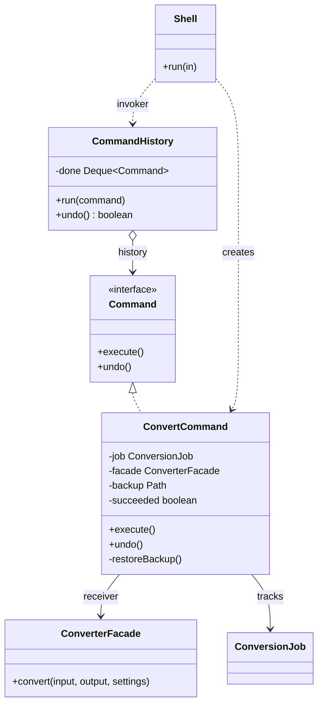
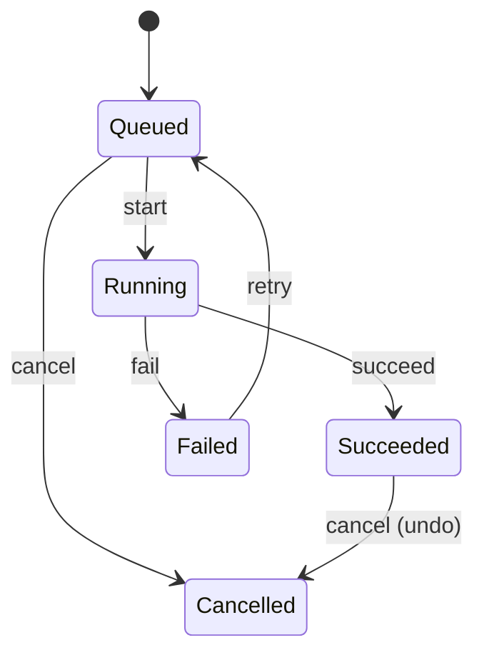
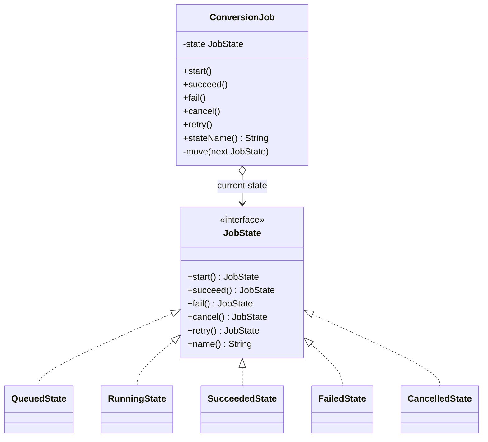
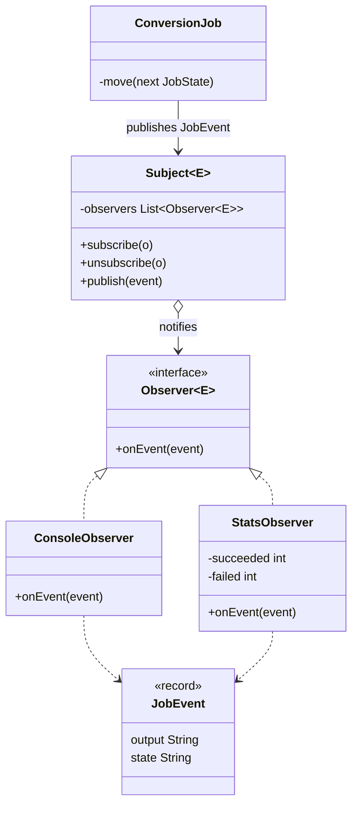
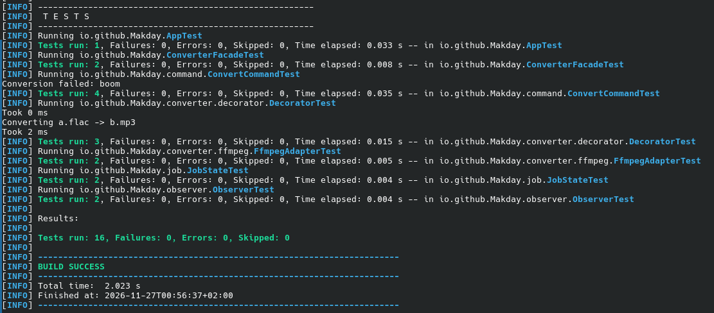

# Laboratory Work No. 3 — Behavioral Design Patterns

**Project:** Universal audio file converter (Java 17, Maven, base package `io.github.Makday`)

## 1. Domain description

The application converts an audio file from one format to another: the user gives an input file and an output file name (optionally a bitrate) and gets the converted file back. The conversion itself is delegated to the external **ffmpeg** program, hidden behind our own `Converter` interface (Lab 2).

In Lab 3 the application became interactive. A small console shell (a read–eval–print loop) keeps the program running, so the user can start several conversions, **undo** a conversion, and turn progress reporting on or off while the program is running. Every conversion is tracked as a *job* with a lifecycle (queued, running, succeeded, failed, cancelled), and interested parts of the program are told when a job changes.

Patterns used:

| Lab | Pattern | Where |
|---|---|---|
| Lab 3 (behavioral) | **Command** | `Command`, `ConvertCommand`, `CommandHistory` |
| Lab 3 (behavioral) | **State** | `ConversionJob`, `JobState` and five concrete states |
| Lab 3 (behavioral) | **Observer** | `Subject`, `Observer`, `ConsoleObserver`, `StatsObserver` |
| Lab 2 (structural, reused) | Facade | `ConverterFacade` is the **receiver** of the Command |
| Lab 2 (structural, reused) | Decorator, Adapter | applied inside the facade on every conversion |
| Lab 1 (creational, reused) | Factory Method, Builder, Singleton | `ConverterCreator`, `ConversionSettings.Builder`, `AppConfig` |

**Interaction path.** One user action passes through all three behavioral patterns and then through the Lab 2 code:

```
Shell  "convert a.wav b.mp3"
  └─ CommandHistory.run(ConvertCommand)                 (Command: invoker)
       ├─ job.start()    Queued → Running               (State)  ── publish ─▶ observers   (Observer)
       ├─ ConverterFacade.convert(...)                  (Command: receiver, Facade)
       │     └─ Factory Method → Decorators → Adapter → ffmpeg
       └─ job.succeed()  Running → Succeeded            (State)  ── publish ─▶ observers   (Observer)

Shell  "undo"
  └─ CommandHistory.undo() → ConvertCommand.undo()
       └─ job.cancel()   Succeeded → Cancelled          (State)  ── publish ─▶ observers   (Observer)
```

### Project structure

```
io.github.Makday
├── App                         entry point, starts the Shell
├── ConverterFacade             Facade (Lab 2), Command receiver
├── cli/Shell                   client: read–eval–print loop, wires everything
├── command/                    Command, ConvertCommand, CommandHistory
├── job/                        ConversionJob (State context), JobState, *State, JobEvent
├── observer/                   Subject, Observer, ConsoleObserver, StatsObserver
├── config/ settings/           Singleton, Builder (Lab 1)
└── converter/                  Converter, creators, decorators, ffmpeg adapter (Lab 1–2)
```

### Shell commands (runtime behavior)

| Input | Effect |
|---|---|
| `convert <in> <out> [kbps]` | creates a job and runs a `ConvertCommand` |
| `undo` | undoes the last executed command |
| `subscribe console\|stats` | subscribes an observer while the program runs |
| `unsubscribe console\|stats` | unsubscribes it again |
| `stats` | prints what the `StatsObserver` has counted |
| `quit` | exits |

Only the console observer is subscribed at start; the statistics are empty until the user types `subscribe stats`. This is the runtime behavior change required by advanced requirement A.

---

## 2. Patterns

### 2.1 Command

**Problem it solves here.** A conversion overwrites its output file (ffmpeg runs with `-y`), so a mistaken `convert` destroys data. Turning the request into an object lets the program keep a **history** and **undo** it: the produced file is removed and the file that was overwritten is put back. A plain method call could not do this because it forgets everything after it returns.

**Roles**

| Role | Class |
|---|---|
| Command | `Command` (`execute()`, `undo()`) |
| ConcreteCommand | `ConvertCommand` |
| Receiver | `ConverterFacade` (does the actual conversion) |
| Invoker | `CommandHistory` (runs commands, keeps the undo stack) |
| Client | `Shell` (creates the commands) |

**Class diagram**



**Code snippet** — [`ConvertCommand.java`](src/main/java/io/github/Makday/command/ConvertCommand.java)

```java
@Override
public void execute() {
  job.start();
  try {
    Path out = Path.of(job.output());
    if (Files.exists(out)) { // keep the file ffmpeg -y would overwrite
      backup = Files.createTempFile("kaleidosound", ".bak");
      Files.move(out, backup, StandardCopyOption.REPLACE_EXISTING);
    }
    facade.convert(job.input(), job.output(), job.settings());
    succeeded = true;
    job.succeed();
  } catch (Exception e) {
    System.err.println("Conversion failed: " + e.getMessage());
    restoreBackup();
    job.fail();
  }
}

@Override
public void undo() {
  if (!succeeded) return; // nothing was produced
  job.cancel();
  try {
    Files.deleteIfExists(Path.of(job.output()));
  } catch (IOException e) {
    throw new UncheckedIOException(e);
  }
  restoreBackup();
  succeeded = false;
}
```

`execute` and `undo` are a symmetric pair: `execute` saves what it is about to overwrite and `undo` puts it back, which is why a command object can be undone later by the invoker. The conversion itself stays in the receiver (`facade.convert`); the command only adds tracking and the undo bookkeeping.

**Unit tests** — [`ConvertCommandTest`](src/test/java/io/github/Makday/command/ConvertCommandTest.java) (stub converter writing into a temporary directory, no ffmpeg needed)

| Test | What it checks |
|---|---|
| `undoRestoresOverwrittenFile` | After `execute` the file contains the new data; after `undo` it contains the exact original content again. |
| `undoRemovesOutputWhenNothingWasOverwritten` | If there was no previous output file, `undo` deletes the produced file. |
| `failedConversionMarksJobFailedAndKeepsOriginal` | If the converter throws, the original file is restored and the job ends in `Failed`. |

---

### 2.2 State

**Problem it solves here.** A conversion job moves through a lifecycle, and which actions are legal depends on where it is: a queued job can be started or cancelled, a running one can succeed or fail, a finished one cannot be started again, a failed one can be retried. Without State this knowledge would be a set of `if`/`switch` checks on a status field repeated in every method. With State each state class knows its own legal transitions, and every other one is rejected.

**Roles**

| Role | Class |
|---|---|
| Context | `ConversionJob` |
| State | `JobState` (interface) |
| ConcreteState | `QueuedState`, `RunningState`, `SucceededState`, `FailedState`, `CancelledState` |

**Transitions**



**Class diagram**



**Code snippet** — [`JobState.java`](src/main/java/io/github/Makday/job/JobState.java), [`QueuedState.java`](src/main/java/io/github/Makday/job/QueuedState.java), [`ConversionJob.java`](src/main/java/io/github/Makday/job/ConversionJob.java)

```java
// JobState: every transition is forbidden unless a concrete state overrides it
default JobState start()   { throw illegal("start"); }
default JobState succeed() { throw illegal("succeed"); }
default JobState fail()    { throw illegal("fail"); }
default JobState cancel()  { throw illegal("cancel"); }
default JobState retry()   { throw illegal("retry"); }

// QueuedState: the only legal transitions out of "Queued"
@Override public JobState start()  { return new RunningState(); }
@Override public JobState cancel() { return new CancelledState(); }

// ConversionJob (context): delegates to the current state and then switches to the result
public void start() { move(state.start()); }

private void move(JobState next) {
  state = next;
  events.publish(new JobEvent(output, next.name()));
}
```

The context contains no condition on the status: `start()` asks the current state, which either returns the next state or throws. In this implementation a state *returns* its successor instead of calling `setState` on the context, so the states are stateless and one line long.

**Unit tests** — [`JobStateTest`](src/test/java/io/github/Makday/job/JobStateTest.java)

| Test | What it checks |
|---|---|
| `allowsValidTransitions` | The path Queued → Running → Failed → Queued → Running → Succeeded works and ends in `Succeeded`. |
| `rejectsForbiddenTransitions` | `succeed()` on a queued job and `start()` on a succeeded job throw `IllegalStateException`. |

---

### 2.3 Observer

**Problem it solves here.** Several independent parts of the program want to know when a job changes state (print progress, count successes and failures, later write a history log), and the user wants to switch them on and off at runtime. `ConversionJob` must not know who is listening, otherwise every new listener would mean editing the job. Observer lets listeners subscribe and unsubscribe themselves.

**Roles**

| Role | Class |
|---|---|
| Subject | `Subject<E>` (subscribe, unsubscribe, publish) |
| Observer | `Observer<E>` (interface) |
| ConcreteObserver | `ConsoleObserver`, `StatsObserver` |
| Event (push model) | `JobEvent` (record: output file and new state name) |
| Event source | `ConversionJob` (publishes on every transition) |

**Class diagram**



**Code snippet** — [`Subject.java`](src/main/java/io/github/Makday/observer/Subject.java)

```java
public class Subject<E> {
  private final List<Observer<E>> observers = new CopyOnWriteArrayList<>();

  public void subscribe(Observer<E> o) {
    observers.add(o);
  }

  public void unsubscribe(Observer<E> o) {
    observers.remove(o);
  }

  public void publish(E event) {
    observers.forEach(o -> o.onEvent(event));
  }
}
```

`Subject` only knows the `Observer` interface, never a concrete observer, and observers can be removed at any time, so which listeners are active is decided at runtime by `subscribe`/`unsubscribe` in the shell. Observers only read the event and never call back into the job, so notifications cannot loop. Note the variation from the textbook: `ConversionJob` *has a* `Subject` (composition) and a single `Subject` is shared by all jobs, instead of each job inheriting from a subject class.

**Unit tests** — [`ObserverTest`](src/test/java/io/github/Makday/observer/ObserverTest.java)

| Test | What it checks |
|---|---|
| `allSubscribedObserversAreNotified` | Two subscribed observers both receive a published event. |
| `unsubscribedObserverIsNotNotified` | An observer that was unsubscribed receives nothing. |

---

## 3. Pattern interaction (test)

The interaction path from section 1 is also covered by a test, [`ConvertCommandTest.commandDrivesStateAndNotifiesObservers`](src/test/java/io/github/Makday/command/ConvertCommandTest.java): one `execute()` followed by one `undo()` of a `ConvertCommand` produces exactly the observer events `Running`, `Succeeded`, `Cancelled`. This proves that the Command changes the State of the job and that each change is announced to the Observers. The same class also has `failedConversionMarksJobFailedAndKeepsOriginal`, which checks the failing path (`Running`, `Failed`).

## 4. Test results

Run with one command:

```
mvn test
```

Output of the JUnit run for the new tests (the Lab 2 tests also pass; 16 tests in total, 0 failed):

```
JUnit Jupiter
 ├─ JobStateTest
 │   ├─ allowsValidTransitions()                              OK
 │   └─ rejectsForbiddenTransitions()                         OK
 ├─ ObserverTest
 │   ├─ allSubscribedObserversAreNotified()                   OK
 │   └─ unsubscribedObserverIsNotNotified()                   OK
 └─ ConvertCommandTest
     ├─ commandDrivesStateAndNotifiesObservers()              OK
     ├─ undoRemovesOutputWhenNothingWasOverwritten()          OK
     ├─ undoRestoresOverwrittenFile()                         OK
     └─ failedConversionMarksJobFailedAndKeepsOriginal()      OK

[ 8 tests found ] [ 8 tests successful ] [ 0 tests failed ]
```



## 5. Requirements coverage

| Requirement | Where |
|---|---|
| Three patterns with full structure | Command (interface, concrete command, invoker, receiver), State (context, interface, 5 states with transitions), Observer (subject, interface, 2 observers, subscribe/unsubscribe) |
| Patterns interact | one `convert` passes through Command → State → Observer (section 1, 3) |
| Client depends on abstractions | `CommandHistory` uses `Command`; `ConversionJob` uses `JobState`; `Subject` uses `Observer`; `Shell` talks to `Subject`/`Observer` types |
| Open for extension | see section 6 |
| Builds on Lab 2 | the Facade is the receiver; Factory Method, Decorators, Adapter and Builder run inside every conversion |
| Behavior changes at runtime (A) | `subscribe` / `unsubscribe` and `undo` in the shell |
| Unit tests, 2+ per pattern (B) | section 2 and 4 |

## 6. Extensibility (open/closed)

- **New state** (e.g. `PausedState`): add one class implementing `JobState` and return it from the transition that should lead to it. Methods it does not override are rejected automatically by the interface defaults.
- **New observer** (e.g. a file logger): add one class implementing `Observer<JobEvent>` and subscribe it. `Subject` and `ConversionJob` do not change.
- **New command** (e.g. a convert-a-whole-folder command): add one class implementing `Command`. `CommandHistory` already runs and undoes any `Command`.

## 7. Conclusions

**What was harder than expected.**

- The Lab 2 `ConverterFacade` caught every exception and only printed it, so the new job could never learn that a conversion had failed. It had to be changed to throw, which is the only edit to existing logic that the behavioral patterns needed.
- Defining what *undo* means for a conversion. Because ffmpeg overwrites the output, undo has to restore the previous file, so the command backs it up before running. The failure path needs the same restore, otherwise a failed conversion would silently destroy the old file.
- Reusing `Succeeded → Cancelled` for undo works but is semantically a stretch. The state diagram needed that transition, and a name like `Reverted` would describe it better.

**What I would design differently.**

- The shell uses a `switch` on the command word. A map from command name to a command factory would let a new command be added without touching `Shell`.
- `JobEvent` carries only the output name and the state name. It should also carry the error message (now printed directly to stderr by `ConvertCommand`) so an observer could report failures.
- `Failed → Queued` (retry) exists and is tested, but there is no `retry` shell command, and a `ConvertCommand` cannot be executed twice because `start()` is not legal from `Failed`. A real retry would need a command that re-queues the job first.
- Redo would be a small addition: a second stack in `CommandHistory` filled by `undo()`.
